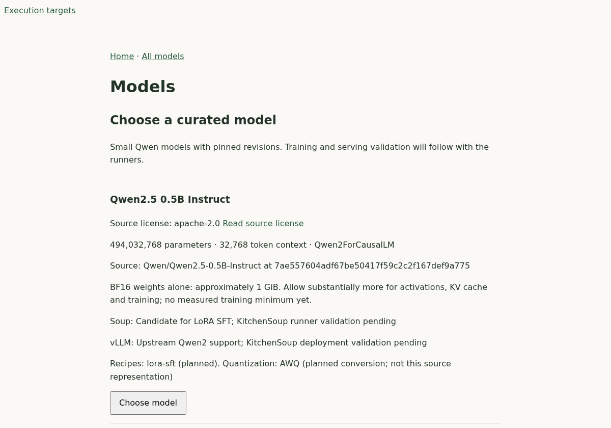
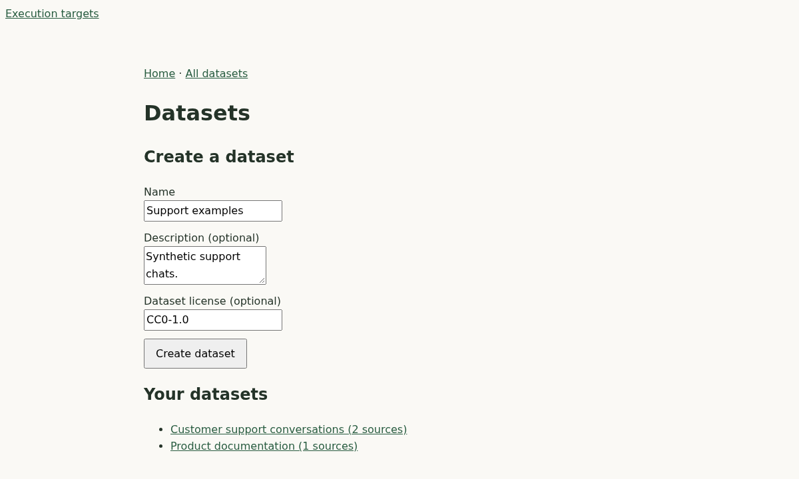
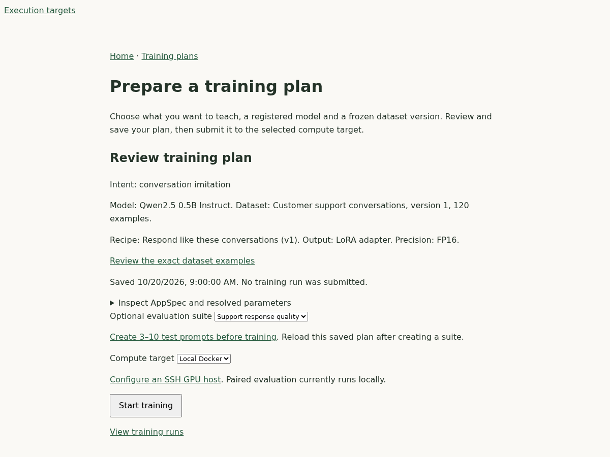

# KitchenSoup

KitchenSoup is a self-hosted control plane for guided language-model fine-tuning.
Import conversations/documents, review immutable datasets and Soup training plans,
register verified model artifacts with lineage, compare results, and serve
temporary vLLM playgrounds.

**Status:** first MVP, version 0.1.0. Training and serving support local Docker,
Docker-over-SSH, Kubernetes, SageMaker and Runpod through explicit opt-ins.
[Validation evidence](docs/evidence/) records the hardware and provider checks
actually performed. This is a trusted single-user application without internal
authentication. GPU execution is disabled in ordinary Compose.

## Quick start

Install Docker Engine and Compose **v2.20+** on Linux or WSL2. No Git checkout,
Python, Make, Node.js or GPU is needed for the published-image installation.

```sh
mkdir kitchensoup && cd kitchensoup
curl -fsSLo compose.yaml https://raw.githubusercontent.com/bdobrica/KitchenSoup/main/deploy/compose.yaml
# Generate private local credentials once; keep .env with your data.
(umask 077; set -C; docker run --rm quay.io/bdobrica/kitchensoup:0.1.0 python -c \
 'import secrets; print("\n".join(k+"="+secrets.token_hex(24) for k in ["KITCHENSOUP_POSTGRES_PASSWORD","RUSTFS_ACCESS_KEY","RUSTFS_SECRET_KEY"]))' > .env)
docker compose up -d --wait
```

Open <http://127.0.0.1:8000>. [Installation](docs/installation.md) covers image
pins, upgrades, backups and executor setup. `docker compose down` retains data.
The app image contains no ML engines; document ingestion uses a separate CPU image.
For development from source see [the developer guide](docs/development.md).
For RTX 20/T4 GPUs select **FP16**.

## UI preview

Screenshots use synthetic sample data; model guidance comes from the bundled catalog.

**Choose a model** — browse curated models, license information and hardware guidance.



**Prepare your data** — create datasets and organize source material.



**Review before training** — inspect the model, frozen dataset version and precision,
then select an evaluation suite and compute target.



## Concepts and guides

KitchenSoup owns orchestration and registry state; Soup and vLLM remain separate
engines. PostgreSQL owns durable metadata, Valkey carries transient wakeups, and
ArtifactStore encapsulates object storage. Model lineage and artifact derivations
are separate. Read [security assumptions](docs/security.md) before network exposure.

- [Architecture](docs/architecture.md), [accepted decisions](docs/adr/), [contracts](docs/contracts/)
- [Executor prerequisites and examples](docs/executors.md), [GPU host workflow](docs/local-training.md)
- [Datasets](docs/datasets.md), [conversations](docs/conversations.md), [documents](docs/documents.md), [dataset versions](docs/dataset-versions.md)
- [Models and lineage](docs/models.md), [license behavior](docs/model-licenses.md)
- [LLM providers](docs/providers.md), [reviewed plans](docs/training-plans.md), [job lifecycle](docs/jobs.md)
- [Evaluation](docs/evaluations.md), [merge/AWQ](docs/representations.md), [playgrounds](docs/deployments.md)
- [Storage](docs/storage.md), [safety and retention](docs/safety-and-retention.md), [OIDCGate perimeter](docs/oidcgate.md)
- [Development](docs/development.md), [all Make targets](docs/commands.md), [contributing](CONTRIBUTING.md)
- [Changelog](CHANGELOG.md), [release process](docs/releases.md), [design](PLAN.md), [milestones](TODO.md)

The browser loads pinned HTMX/Alpine scripts from jsDelivr; enhancements require
internet access. Dependencies are not fully transitively locked.

## License

[Apache-2.0](LICENSE). Models, datasets and runtime dependencies retain their own
terms; see [third-party notices](THIRD_PARTY_NOTICES.md).
