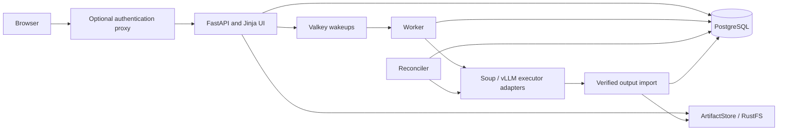

# Architecture

KitchenSoup is a trusted, single-user control plane. It owns reviewed plans,
immutable input identities, lifecycle state, artifact verification and registration.
Soup owns training/document execution; vLLM owns inference. Neither engine owns
KitchenSoup metadata or receives control-plane credentials by default.

PostgreSQL is authoritative for IDs, immutable dataset/plan/run snapshots, events,
model lineage, leases and durable commands. Valkey is a transient wakeup mechanism;
its loss cannot authorize execution or erase a submitted command. ArtifactStore
encapsulates S3-compatible object access. Model ancestry and byte-artifact
derivations are separate graphs. See [database](database.md), [storage](storage.md),
[jobs](jobs.md) and [models](models.md).

Submission commits queued intent before external effects. Workers claim commands;
reconcilers observe execution, collect and verify manifests/hashes, register
outputs and retry cleanup. Process exit zero or provider state alone cannot prove
training success. Explicit retries create new attempts; uncertain cloud allocation
is reconciled rather than blindly repeated. Preserve private staging and ownership
journals across restarts, alongside PostgreSQL and artifact storage.

| Backend | Training | Temporary serving | Transport / boundary |
| --- | --- | --- | --- |
| Local Docker | Soup container | vLLM container | Private bind mounts; internal bridge for inference |
| Docker over SSH | Remote Docker | Remote Docker | Verified SSH/SFTP; inference over SSH forwarding |
| Kubernetes | Job + staging Pod/PVC | Private Pod/Service | Authenticated Kubernetes API/exec; no public service |
| SageMaker | Managed Training Job | BYOC Endpoint | Private regional S3/ECR; SigV4 invocation |
| Runpod | Ephemeral direct Soup Pod | Separate direct vLLM Pod | Full public-IP SSH/SFTP; authenticated HTTPS inference |

[Executor setup](executors.md) describes prerequisites and approved credential
references. Infrastructure stays outside AppSpec. Default Compose enables no GPU
executor and mounts no Docker socket or host keys. Evaluation and merge/AWQ use
local executors; remote execution support does not imply remote evaluation.

The browser talks to KitchenSoup for playground requests. The selected executor
resolves and verifies its owned endpoint; client-provided URLs never choose an
inference destination. Playground leases require a live reconciler and reachable
provider. Cleanup is independent of outcome and can remain pending after failure.
See [security](security.md) and [deployment lifecycle](deployments.md).

Accepted decisions live in [ADRs](adr/). Published wire schemas and OpenAPI live
in [contracts](contracts/). They take precedence over implementation sequencing
in PLAN/TODO. This overview does not introduce a new cross-component API.
