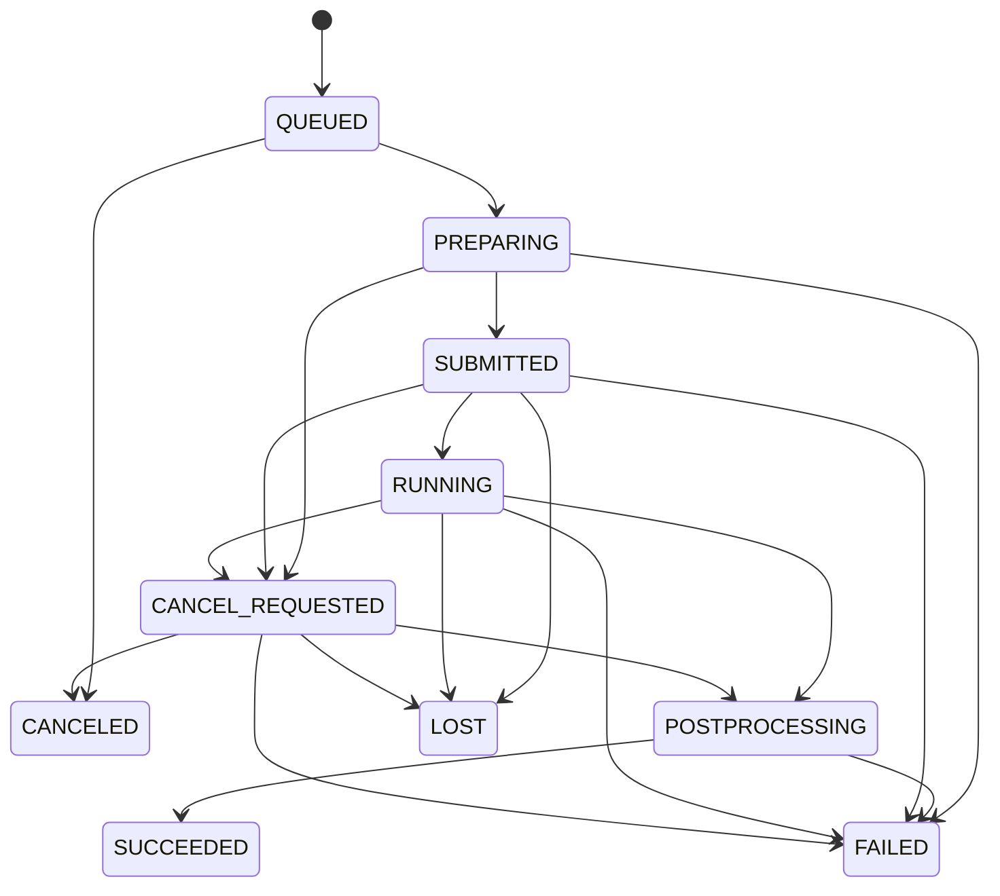

# Training jobs, worker and reconciler

[ADR 0014](adr/0014-durable-training-lifecycle.md) defines the durable lifecycle.
PostgreSQL owns the current run state and append-only event history. Valkey carries
UUID-only command hints and transient update publications; missed or duplicate
messages do not lose runs or authorize another launch.

## Run the host processes

Follow [local training](local-training.md) to migrate and prepare local inputs and
the pinned trainer image. `make training-infra` exposes PostgreSQL, Valkey and
RustFS on loopback. Use three terminals, with the same checkout, non-root user,
settings and private workspace:

```sh
make dev-training
make worker-training
make reconcile-training
```

The web process saves runs and cancel requests. The worker prepares/submits runs
and executes cancellation. The reconciler observes launched jobs independently
of the browser. Restarting the web process does not stop training. Background
processes scan PostgreSQL every two seconds, including when Valkey is unavailable.
A slow preparation can delay that worker's other commands; it does not block a
web cancel request or the independent reconciler. Additional workers use the same
PostgreSQL claims. This is not a GPU capacity scheduler.

The ordinary Compose background services have working dispatch loops but remain
without local training authority or a Docker socket. Do not enable training there
without an explicitly designed host/workspace configuration. The supported local
training deployment is the opt-in host workflow above.

Apply migration `0010_job_state_guards` with `make migrate` before starting updated
processes. Stop older host application processes first: their synchronous inserts
are incompatible with the new QUEUED insertion guard. Existing plans/run snapshots
are unchanged. Existing runs get a baseline event where their current state is not
already represented; historical transitions are not fabricated. Migrations do not
launch, stop or retry containers.

## State and recovery



Every edge and the initial QUEUED state append a sequenced `job_events` row in the
same transaction. Invalid transitions fail in Python and PostgreSQL; terminal
states cannot change. Input snapshots remain immutable. Same-state updates do not
append duplicate events. Success still requires the executor's verified training
manifest and adapter hashes; a zero exit code or CPU validation alone is insufficient.
POSTPROCESSING currently completes this verification; model registration comes later.

Each external operation uses a per-run database advisory claim. Short state updates
also lock the run row. The claim transaction retains its connection while external
work proceeds, allowing web cancellation to commit independently. Process/connection
death releases the claim. Workspace locks remain in force, and the worker never
replays submit on a PREPARING run.

After a worker restart, an existing verified launch is adopted. An abandoned
preparation with no container fails; an unstarted created container is stopped
and the attempt fails. Use **Retry as a new run** for a fresh attempt. A daemon
error leaves state unchanged for later polling. Confirmed absence after submission
becomes LOST. Terminal status survives container cleanup and application restart.

Cancellation is immediate for QUEUED; preparation or training records
CANCEL_REQUESTED for the worker. A successful completion that wins the cancellation
race is retained as SUCCEEDED. Repeated requests are harmless. A clone is allowed
only after a terminal result and retains the original plan, parameters and pinned
image, using a new run UUID, workspace and event history. To change parameters,
create a new reviewed plan instead. Every create/clone POST creates a new attempt;
clients must not automatically repeat a lost create response.

## API and live progress

Existing routes and response fields are retained in the generated
[v1 OpenAPI](contracts/artifacts-v1.openapi.json). Creation still returns 201, now
with durable QUEUED state. GET returns the database snapshot without observing
Docker; the nullable `observation` field is retained and normally null. Cancel
returns CANCELED for an unclaimed queued run or CANCEL_REQUESTED for active work.
Container deletion returns 409 until the run is terminal and its claim is free.

Additional routes:

| Method/path | Behavior |
| --- | --- |
| `POST /api/v1/training-runs/{id}/clone` | Clone terminal immutable input; 201 |
| `GET /api/v1/training-runs/{id}/events?after=-1` | SSE; replay events after sequence |

SSE `transition` frames have a numeric `id` and JSON data containing `sequence`,
`status`, `created_at` and nullable `message`. `status` frames contain the existing
RunView database snapshot and no event ID. `Last-Event-ID` overrides `after` when
reconnecting. Invalid cursors return 422, missing runs 404. Connections send
heartbeat comments and reconnect after roughly a minute; terminal snapshots close
the stream after draining committed transitions. The UI closes its terminal
EventSource, retains progress history, reads stdout/stderr with byte cursors, and
keeps five-second refresh as a fallback. All log text is rendered as text.

Valkey publications wake streams but contain only run UUIDs. Database replay repairs
missed messages; no message payload becomes browser-visible authority. SSE and all
run metadata use `Cache-Control: no-store`. Logs remain private to the trusted local
application and can contain training diagnostics.

## Verification

`make verify` checks state-machine units, API schema drift, formatting, lint and
types. `make test-integration` provisions disposable PostgreSQL, RustFS and Valkey
and tests transition/event atomicity, claims, duplicate dispatch, cancellation
races, recovery, retry snapshots, SSE replay and separate-process execution across
web restart. No actual GPU training or model-quality claim is made by these tests.
